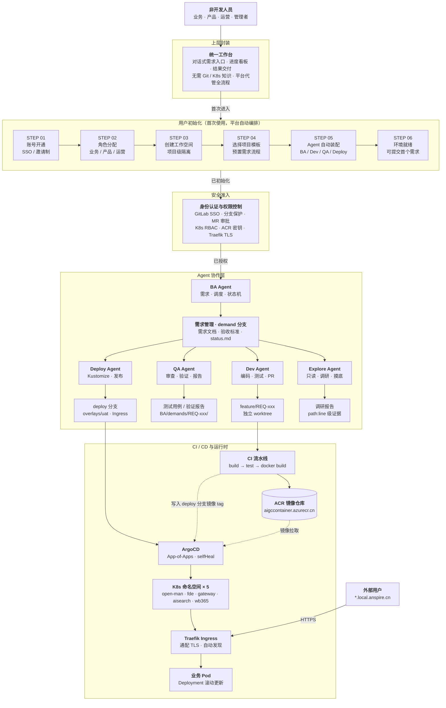
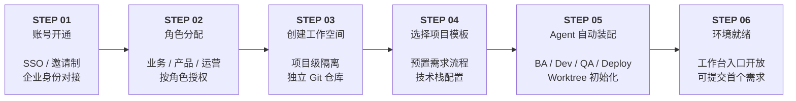
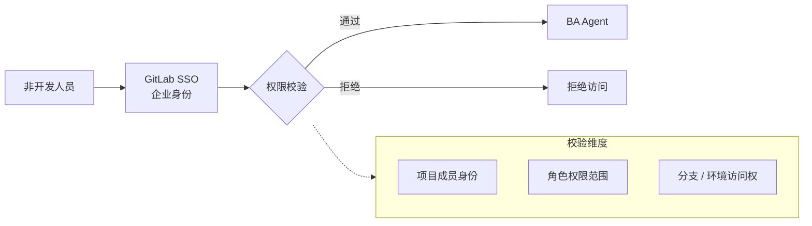
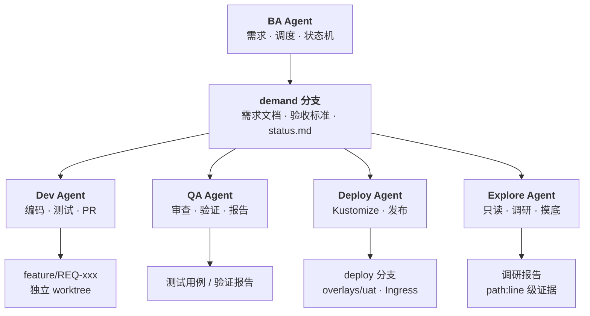
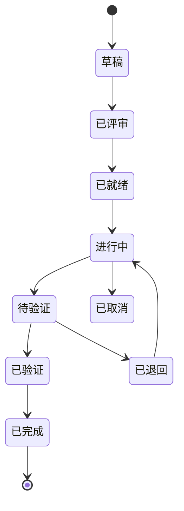
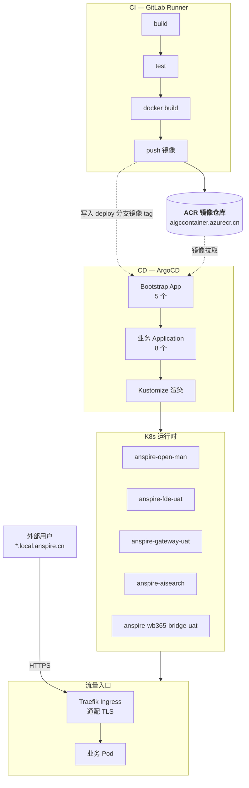
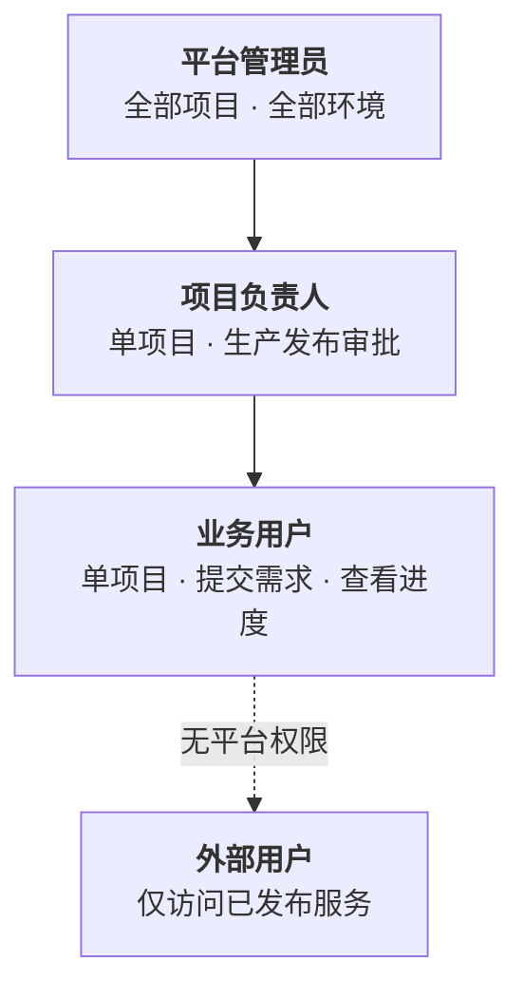

# Agent Workspace 架构图

> 面向非开发人员的 Agent 协作平台 · 上层封装 + 用户初始化 + 权限控制 + 多 Agent 协作

---

## 目录

1. [整体架构](#1-整体架构)
2. [用户初始化流程](#2-用户初始化流程)
3. [身份认证与权限控制](#3-身份认证与权限控制)
4. [Agent 协作层](#4-agent-协作层)
5. [CI / CD 与运行时](#5-ci--cd-与运行时)
6. [权限控制矩阵](#6-权限控制矩阵)
7. [关键角色说明](#7-关键角色说明)

---

## 1. 整体架构

---

## 2. 用户初始化流程

非开发人员首次使用平台时，由平台自动编排六步初始化，用户无需接触任何 Git / K8s 操作。

### 步骤说明

| 步骤 | 动作 | 平台行为 | 用户感知 |
|------|------|---------|---------|
| 01 | 账号开通 | 对接企业 SSO 或发送邀请 | 登录工作台 |
| 02 | 角色分配 | 按角色授予不同项目访问范围 | 看到自己的工作区 |
| 03 | 创建工作空间 | 创建独立 Git 仓库 + 隔离命名空间 | 获得一个项目空间 |
| 04 | 选择项目模板 | 注入预置需求流程与技术栈配置 | 选择业务类型即可 |
| 05 | Agent 自动装配 | 拉起 BA / Dev / QA / Deploy 角色，初始化 worktree | 无需操作，后台完成 |
| 06 | 环境就绪 | 开放工作台入口 | 可以提第一个需求 |

---

## 3. 身份认证与权限控制

初始化完成后，所有操作经过统一的安全准入层。

### 各组件权限点

| 组件 | 控制手段 |
|------|---------|
| **GitLab** | 分支保护 · MR 审批 · CODEOWNERS |
| **Kubernetes** | RBAC · ServiceAccount · NetworkPolicy |
| **ACR** | 拉取密钥（`azurecr-pull`）· 推送权限 |
| **Traefik** | 通配 TLS · 认证中间件 · 路由隔离 |
| **ArgoCD** | Project 隔离 · sync 权限 · 仓库凭据 |

---

## 4. Agent 协作层

### 4.1 角色分工

| 角色 | 职责 | 产出 | 写入权限 |
|------|------|------|---------|
| **BA Agent** | 需求拆解、任务调度、状态机唯一更新者 | 需求文档、验收标准、status.md | `demand` 分支 |
| **Dev Agent** | 编码实现、单元/集成测试、创建 PR | 源码、测试、追溯性矩阵 | `feature/REQ-xxx` |
| **QA Agent** | 代码审查、验证、出具报告 | 测试用例、验证报告 | 只读，报告给 BA |
| **Deploy Agent** | Kustomize 配置、镜像 tag、Ingress | 部署配置、发布记录 | `deploy` 分支 |
| **Explore Agent** | 代码调研、风险识别 | path:line 级调研报告 | 只读 |

### 4.2 需求状态机

**状态更新权归 BA 独占**：Dev 完成只通知 BA，QA 审核只报告 BA。

---

## 5. CI / CD 与运行时

### 关键规范

| 维度 | 规范 |
|------|------|
| 镜像 tag | `aigccontainer.azurecr.cn/<service>:uat-YYYYMMDD-N` |
| 命名空间 | `<project>-<env>`，如 `anspire-fde-uat` |
| 域名 | `api-<service>-<env>.local.anspire.cn` |
| 同步策略 | `selfHeal: true` · `prune: false` · `ApplyOutOfSyncOnly` |
| IngressClass | `traefik` + 通配证书 `wildcard-local-anspire-cn` |

> `deploy` 分支**不参与构建**。CI 只产出镜像，CD 只消费镜像 tag。

---

## 6. 权限控制矩阵

| 组件 | 控制手段 | 作用范围 |
|------|---------|---------|
| **GitLab** | 分支保护 · MR 审批 · CODEOWNERS | 防止误改主干、强制代码评审 |
| **Kubernetes** | RBAC · ServiceAccount · NetworkPolicy | 命名空间级隔离、Pod 网络策略 |
| **ACR** | 拉取密钥（`azurecr-pull`）· 推送权限 | 镜像拉取鉴权、构建推送控制 |
| **Traefik** | 通配 TLS · 认证中间件 · 路由隔离 | HTTPS 终止、访问认证 |
| **ArgoCD** | Project 隔离 · sync 权限 · 仓库凭据 | 应用级隔离、部署权限 |

### 权限层级

---

## 7. 关键角色说明

### 非开发人员视角

| 场景 | 传统方式 | 本平台 |
|------|---------|--------|
| 提需求 | 写文档、开会、邮件 | 在工作台对话式描述 |
| 看进度 | 问开发、查 Jira | 实时进度看板 |
| 验收结果 | 等测试报告 | 结果交付物直接可见 |
| 环境准备 | 提 IT 工单 | 初始化流程自动完成 |

### 技术底座视角

平台对非开发人员隐藏了以下复杂度：

- **Git 分支模型**：`workspace` / `demand` / `deploy` / `develop` / `feature` 五类分支
- **Worktree 隔离**：每个需求独立 worktree，互不干扰
- **多 Agent 协作**：BA 统一调度，Dev / QA / Deploy / Explore 分工执行
- **CI/CD 链路**：GitLab Runner 构建 → ACR 镜像 → ArgoCD 同步 → K8s 滚动更新
- **Ingress 注册**：Ingress 资源声明即自动注册到 Traefik，无需手工配置
