# Agent Workspace 系统架构设计

> 基于实际运行的 K8s 集群观测（context: `anspire-k8-admin@anspire-dify`）
> 观测时间：2026-10-19 | 集群：v1.33.x | Git：GitLab（`gitlab.anchnet.com`）

**范围界定**：本文档聚焦 **ArgoCD 托管的交付链路**（5 个 bootstrap + 8 个业务应用）。

---

## 目录

1. [系统全景](#1-系统全景)
2. [分层技术架构](#2-分层技术架构)
3. [Git 与 Worktree 模型](#3-git-与-worktree-模型)
4. [Agent 协作架构](#4-agent-协作架构)
5. [CI 架构：GitLab](#5-ci-架构gitlab)
6. [CD 架构：ArgoCD](#6-cd-架构argocd)
7. [K8s 集群结构](#7-k8s-集群结构)
8. [Ingress 自动注册](#8-ingress-自动注册)
9. [端到端交付流程](#9-端到端交付流程)
10. [规范汇总](#10-规范汇总)
11. [风险点](#11-风险点)
12. [演进建议](#12-演进建议)

---

## 1. 系统全景

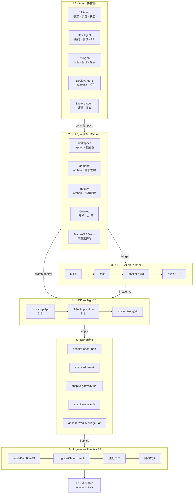

---

## 2. 分层技术架构

| 层 | 职责 | 技术选型 |
|----|------|---------|
| L7 | 用户 / 外部流量 | HTTPS 强制重定向，通配证书 |
| L6 | K8s 运行时 | Deployment / StatefulSet |
| L5 | CD | ArgoCD（App-of-Apps）+ Kustomize |
| L4 | 制品 | ACR：`aigccontainer.azurecr.cn` |
| L3 | CI | GitLab Runner（Kubernetes executor） |
| L2 | Git | GitLab 分支模型（3 个 orphan 分支） |
| L1 | Agent 协作 | Agent Plugins v1.0.0 + Agent Skills |

**基础设施**：Kubernetes v1.33.x、Flannel CNI。

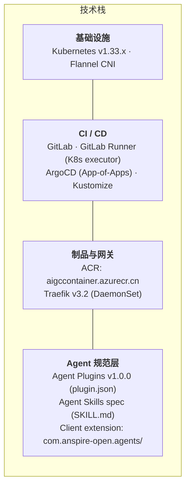

---

## 3. Git 与 Worktree 模型

### 3.1 平铺布局

所有 worktree 在仓库根**物理平铺**，无中间目录层、无嵌套。

```text
<repo-root>/                     ← workspace 分支（根容器，只跟踪 2 个文件）
├── .git/
├── README.md
├── .gitignore                   ← 双层防御：白名单 + /*/ 屏蔽
│
├── code/                        ← [worktree] develop 分支 — 业务源码
├── BA/                          ← [worktree] demand 分支  — 需求管理
├── Deploy/                      ← [worktree] deploy 分支  — 部署配置
├── feature-REQ-001/             ← [worktree] feature/REQ-001 — 需求开发（临时）
├── feature-REQ-002/
├── hotfix-xxx/                  ← [worktree] hotfix/xxx      — 紧急修复（临时）
└── .local/                      ← 未定稿中间文件（不跟踪）
```

### 3.2 分支拓扑

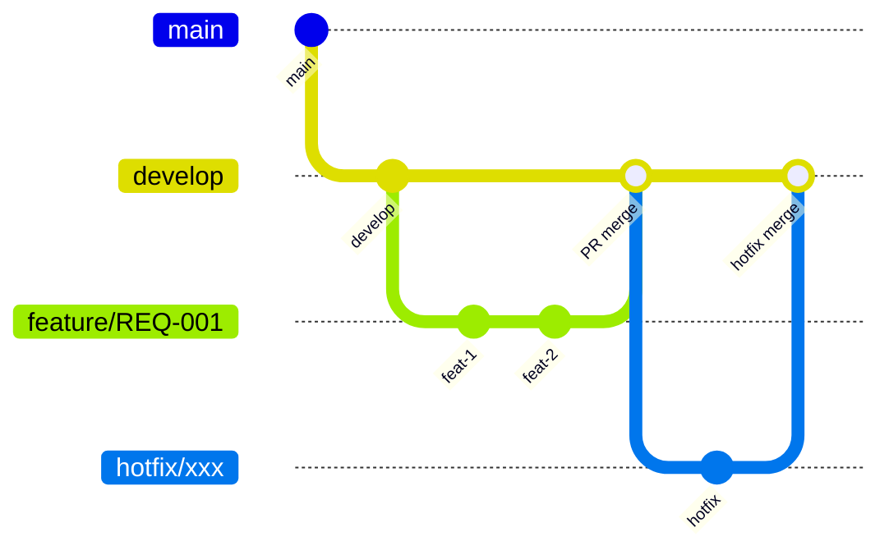

**orphan 组**（互无父节点，各自管理 `.gitignore`）：

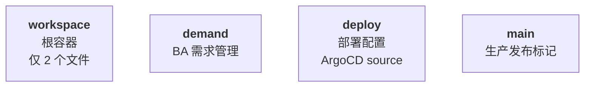

### 3.3 分支职责

| 分支 | 类型 | 归属 worktree | 写入者 | 内容 | 基分支 |
|------|------|--------------|--------|------|--------|
| `workspace` | orphan | 仓库根 | BA（极少） | 仅 README + .gitignore | — |
| `main` | orphan | 无 | 发布管理员 | 生产发布标记 | — |
| `develop` | 普通 | `code/` | 合并写入 | 业务源码、CI 配置 | `main` |
| `demand` | orphan | `BA/` | BA Agent | 需求文档、调度表 | — |
| `deploy` | orphan | `Deploy/` | Deploy Agent / CI | Kustomize、Application、Ingress | — |
| `feature/REQ-xxx` | 功能 | `feature-REQ-xxx/` | Dev Agent | 单需求开发 | `develop` |
| `hotfix/xxx` | 修复 | `hotfix-xxx/` | Dev Agent | 紧急修复 | `main` |

### 3.4 .gitignore 双层防御

```gitignore
*              # 全忽略
!*/            # 保留目录遍历
!.gitignore
!README.md
/*/            # 屏蔽所有第一层子目录（worktree 都在第一层）
```

即使误操作 `git add .`，workspace 分支也只跟踪 2 个文件。

---

## 4. Agent 协作架构

### 4.1 角色职责

| 角色 | 工作区 | 写入分支 | 核心职责 |
|------|--------|---------|---------|
| **BA** | `BA/` | `demand` | 需求文档、状态机唯一更新者、REQ 认领、worktree 生命周期、巡检 |
| **Dev** | `feature-REQ-xxx/` | `feature/REQ-xxx` | TDD 编码、单元/集成测试、追溯性矩阵、自验证、PR |
| **QA** | feature worktree（只读） | 无直接写入 | 测试用例设计、追溯性审查、代码审查、只报告 BA |
| **Deploy** | `Deploy/` | `deploy` | Kustomize overlay、镜像 tag、Ingress、回滚 |
| **Explore** | 任意（只读） | 无 | 代码调研、调用链追踪、风险识别、path:line 证据 |

### 4.2 需求状态机

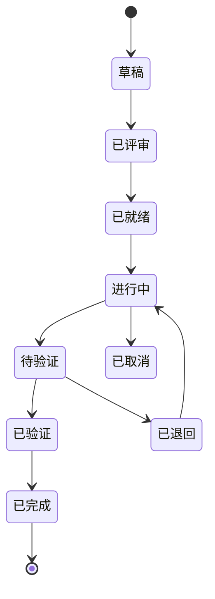

**状态更新权归 BA 独占**：Dev 完成只通知 BA，QA 审核只报告 BA。

### 4.3 多 BA 并发协作

**Session ID**：`{role}-{hostname}-{pid}-{YYYYMMDD}-{HHmmss}`
例：`ba-janedoe-mbp-38472-20260915-143022`

**懒注册流程**（注册绑定在首次写操作中，无法跳过）：

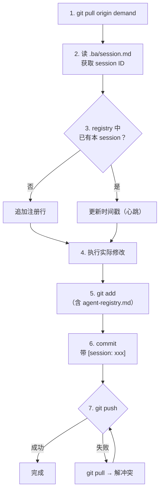

**REQ 编号认领**：写需求前先 `git pull` → 读 `req-registry.md` → 认领 → push；
push 被拒说明他人已抢号，自动换下一个编号重试。

**超时判定**：超过 30 分钟无 commit 的 session 标记 `stale`，
用 `git log --grep="[session: xxx]" -1` 追溯真实最后活动时间。

---

## 5. CI 架构：GitLab

### 5.1 Runner 配置（实测）

| 项目 | 值 |
|------|-----|
| GitLab 地址 | `https://gitlab.anchnet.com` |
| 部署位置 | namespace `gitlab-runner` |
| Executor | `kubernetes` |
| Runner 名称 | `k8s-group-runner` |
| Tags | `k8s`, `qa`, `shared` |
| 并发度 | `concurrent = 4` |
| 默认镜像 | `alpine:3.12` |
| 单 Job 资源 | request 1C/4Gi，limit 4C/8Gi |
| 特权模式 | `privileged = true` |
| 挂载 | `hostPath /var/run/docker.sock` |
| 缓存后端 | MinIO S3：`minio-service.middlewave.svc.cluster.local:9000` |
| 缓存 bucket | `gitlab-runner-cache` |
| 镜像拉取密钥 | `azurecr-pull` |

### 5.2 流水线

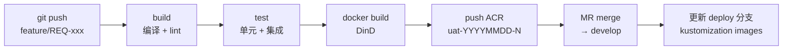

**镜像 tag 规范**：`aigccontainer.azurecr.cn/<service>:uat-YYYYMMDD-N`
实例：`anspire-fde-backend:uat-20261016-80`

> `deploy` 分支**不参与构建**。CI 只产出镜像，CD 只消费镜像 tag。

### 5.3 Runner 架构

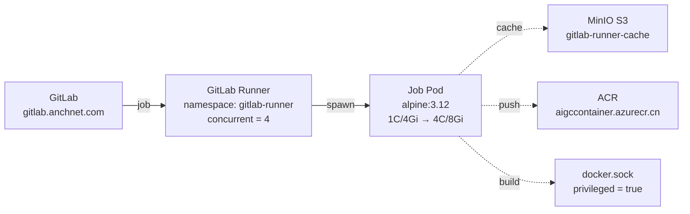

---

## 6. CD 架构：ArgoCD

### 6.1 App-of-Apps 两层结构

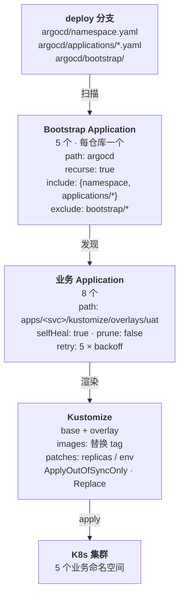

### 6.2 Application 清单（实测 13 个）

| Application | 类型 | 仓库 | 路径 | 命名空间 | 状态 |
|-------------|------|------|------|---------|------|
| `anspire-open-man-bootstrap` | bootstrap | anspire_atomic_power_backend | `argocd` | argocd | OutOfSync |
| `anspire-aisearch-bootstrap` | bootstrap | anspire-open-global-backend | `argocd` | argocd | Synced |
| `anspire-fde-bootstrap` | bootstrap | anspire-fde-hub | `argocd` | argocd | Synced |
| `anspire-llm-gateway-bootstrap` | bootstrap | anspire-llm-gateway | `argocd` | argocd | Synced |
| `anspire-wb365-bridge-bootstrap` | bootstrap | wb365-bridge | `argocd` | argocd | Synced |
| `aisearch-api-uat` | 业务 | anspire_atomic_power_backend | `apps/aisearch-api/kustomize/overlays/uat` | anspire-open-man | Synced |
| `anspire-open-admin-uat` | 业务 | anspire-admin-frontend | `apps/anspire-open-admin/kustomize/overlays/uat` | anspire-open-man | OutOfSync |
| `anspire-open-operate-uat` | 业务 | anspire-operate-frontend | `apps/anspire-open-operate/kustomize/overlays/uat` | anspire-open-man | Synced |
| `aisearch-global-api-uat` | 业务 | anspire-open-global-backend | `apps/aisearch-global-api/kustomize/overlays/uat` | anspire-aisearch | Synced |
| `anspire-fde-backend-uat` | 业务 | anspire-fde-hub | `apps/anspire-fde-backend/kustomize/overlays/uat` | anspire-fde-uat | Synced |
| `anspire-fde-frontend-uat` | 业务 | anspire-fde-hub | `apps/anspire-fde-frontend/kustomize/overlays/uat` | anspire-fde-uat | Synced |
| `anspire-llm-gateway-uat` | 业务 | anspire-llm-gateway | `apps/gateway/overlays/uat` | anspire-gateway-uat | Synced |
| `anspire-wb365-bridge-uat` | 业务 | wb365-bridge | `apps/anspire-wb365-bridge/kustomize/overlays/uat` | anspire-wb365-bridge-uat | OutOfSync |

### 6.3 deploy 分支目录规范

```text
Deploy/                                ← deploy 分支 worktree
├── argocd/
│   ├── namespace.yaml
│   ├── applications/                  ← bootstrap 扫描此目录
│   │   ├── aisearch-api.yaml
│   │   └── ...
│   └── bootstrap/                     ← exclude，避免自引用
│
└── apps/
    ├── aisearch-api/
    │   └── kustomize/
    │       ├── base/
    │       │   ├── kustomization.yaml
    │       │   ├── deployment.yaml
    │       │   ├── service.yaml
    │       │   └── ingress.yaml
    │       └── overlays/
    │           └── uat/
    │               ├── kustomization.yaml   ← 镜像 tag 在此更新
    │               ├── patch-replicas.yaml
    │               └── patch-env.yaml
    └── ...
```

---

## 7. K8s 集群结构

### 7.1 命名空间

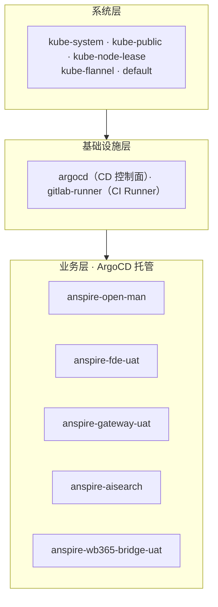

| 层级 | 命名空间 |
|------|---------|
| 系统 | `kube-system`、`kube-public`、`kube-node-lease`、`kube-flannel`、`default` |
| 基础设施 | `argocd`（CD 控制面）、`gitlab-runner`（CI Runner） |
| 业务（ArgoCD 托管） | `anspire-open-man`、`anspire-fde-uat`、`anspire-gateway-uat`、`anspire-aisearch`、`anspire-wb365-bridge-uat` |

### 7.2 基础设施要点

| 项目 | 值 |
|------|-----|
| Kubernetes | v1.33.x |
| CNI | Flannel |
| Ingress | Traefik v3.2（DaemonSet） |
| CD | ArgoCD（App-of-Apps） |

---

## 8. Ingress 自动注册

### 8.1 组件（实测）

| 项目 | 值 |
|------|-----|
| Ingress Controller | Traefik v3.2 |
| 部署形态 | DaemonSet |
| IngressClass | `traefik` |
| EntryPoints | `web:80`、`websecure:443`、`metrics:9100`、`dashboard:9000`、`traefik:8080` |
| HTTP → HTTPS | 永久重定向（301） |
| 对外暴露 | NodePort `80:80` / `443:443` |
| TLS 证书 | Secret `wildcard-local-anspire-cn`（`*.local.anspire.cn`） |
| 默认证书 | ConfigMap `traefik-tls-config` → `defaultCertificate` |

### 8.2 自动注册链路

```mermaid
sequenceDiagram
    participant Dev as Dev Agent
    participant Git as GitLab<br/>(deploy 分支)
    participant Argo as ArgoCD
    participant K8s as K8s API
    participant TF as Traefik
    participant User as 外部用户

    Dev->>Git: 提交 ingress.yaml
    Note over Git: ingressClassName: traefik<br/>host: api-&lt;svc&gt;-uat.local.anspire.cn<br/>tls.secretName: wildcard-local-anspire-cn
    Git->>Argo: Webhook / 轮询（selfHeal=true）
    Argo->>Argo: Kustomize 渲染 overlay
    Argo->>K8s: Apply Ingress 资源
    K8s-->>TF: Ingress 变更事件（Watch）
    TF->>TF: 生成路由规则 + 绑定 TLS
    Note over TF: 自动注册完成，无需重启
    User->>TF: HTTPS 请求
    TF->>K8s: 转发到 Service
    K8s-->>User: 响应
```

### 8.3 请求路径

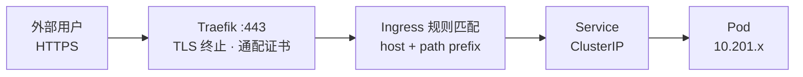

### 8.4 Ingress 标准模板（实测格式）

```yaml
apiVersion: networking.k8s.io/v1
kind: Ingress
metadata:
  name: anspire-fde-backend
  namespace: anspire-fde-uat
  labels:
    app.kubernetes.io/name: anspire-fde-backend
    app.kubernetes.io/component: backend
    app.kubernetes.io/instance: anspire-fde-uat
    app.kubernetes.io/part-of: anspire-fde
  annotations:
    traefik.ingress.kubernetes.io/router.tls: "true"
spec:
  ingressClassName: traefik
  rules:
    - host: api-fde-uat.local.anspire.cn
      http:
        paths:
          - path: /
            pathType: Prefix
            backend:
              service:
                name: anspire-fde-backend
                port:
                  number: 8080
  tls:
    - hosts:
        - api-fde-uat.local.anspire.cn
      secretName: wildcard-local-anspire-cn
```

### 8.5 域名命名规范

| 服务类型 | 模式 | 实例 |
|---------|------|------|
| 后端 API | `api-<service>-<env>.local.anspire.cn` | `api-fde-uat` |
| 前端 Web | `<service>-<env>.local.anspire.cn` | `fde-uat` |
| 网关 | `gateway-<env>.local.anspire.cn` | `gateway-uat` |
| 平台工具 | `<tool>.local.anspire.cn` | `argocd` |

### 8.6 ArgoCD 托管应用的路由

| 命名空间 | Ingress | Host | TLS |
|---------|---------|------|-----|
| anspire-open-man | aisearch-api | `api-aisearch-api-uat.local.anspire.cn` | ✗ |
| anspire-open-man | anspire-open-admin | `open-admin-uat.local.anspire.cn` | ✓ |
| anspire-open-man | anspire-open-operate | `open-opt.local.anspire.cn` | ✓ |
| anspire-aisearch | aisearch-global-api | `api-aisearch-global-api-uat.local.anspire.cn` | ✗ |
| anspire-fde-uat | anspire-fde-backend | `api-fde-uat.local.anspire.cn` | ✓ |
| anspire-fde-uat | anspire-fde-frontend | `fde-uat.local.anspire.cn` | ✓ |
| anspire-gateway-uat | gateway-ingress | `gateway-uat.local.anspire.cn` | ✓ |
| anspire-wb365-bridge-uat | anspire-wb365-bridge | `api-wb365-uat.local.anspire.cn` | ✓ |

---

## 9. 端到端交付流程

```mermaid
flowchart TD
    subgraph P1["① 需求 — BA Agent"]
        A1["用户提出需求"] --> A2["创建 demand.md<br/>+ acceptance.md"]
        A2 --> A3["状态：草稿 → 已评审 → 已就绪"]
        A3 --> A4["认领 REQ 编号<br/>req-registry.md"]
        A4 --> A5["创建 worktree<br/>feature-REQ-xxx"]
    end

    subgraph P2["② 开发 — Dev Agent"]
        B1["读取 BA 需求文档<br/>+ QA 测试用例"] --> B2["TDD 编码<br/>+ 单元/集成测试"]
        B2 --> B3["自验证<br/>追溯性矩阵 · 测试 · Lint"]
        B3 --> B4["通知 BA<br/>（不直接改状态）"]
    end

    subgraph P3["③ 验证 — QA Agent"]
        C1["BA 置「待验证」"] --> C2["QA 代码审查<br/>+ 跑测试 + 追溯性核对"]
        C2 --> C3{"通过？"}
        C3 -->|"否"| C4["BA 置「已退回」"]
        C3 -->|"是"| C5["BA 置「已验证」<br/>通知 Dev 创建 PR"]
    end

    subgraph P4["④ 集成 — CI"]
        D1["PR → develop"] --> D2["Runner 构建<br/>build + test"]
        D2 --> D3["docker build"]
        D3 --> D4["push ACR<br/>uat-YYYYMMDD-N"]
        D4 --> D5["MR merge → develop"]
        D5 --> D6["更新 deploy 分支<br/>镜像 tag"]
    end

    subgraph P5["⑤ 部署 — CD"]
        E1["ArgoCD 检测变更"] --> E2["Kustomize 渲染 overlay"]
        E2 --> E3["Apply K8s<br/>Deployment 滚动更新"]
        E3 --> E4["Ingress 自动注册<br/>Traefik 发现"]
    end

    subgraph P6["⑥ 运行时验证 — QA"]
        F1["staging e2e 验证"] --> F2{"通过？"}
        F2 -->|"否"| F3["git revert<br/>回滚部署"]
        F2 -->|"是"| F4["BA 置「已完成」<br/>Dev 清理 worktree"]
    end

    subgraph P7["⑦ 生产发布 — Deploy Agent"]
        G1["更新 production overlay<br/>镜像 tag"] --> G2["ArgoCD 同步"]
        G2 --> G3["healthcheck"]
        G3 --> G4["记录 releases/"]
    end

    A5 --> B1
    B4 --> C1
    C4 --> B2
    C5 --> D1
    D6 --> E1
    E4 --> F1
    F4 --> G1
```

---

## 10. 规范汇总

| 维度 | 规范 | 实例 |
|------|------|------|
| 需求编号 | `REQ-{三位数字}` | `REQ-001` |
| 分支 | `feature/REQ-xxx` | `feature/REQ-001` |
| Worktree | `feature-REQ-xxx` | `feature-REQ-001` |
| 命名空间 | `<project>-<env>` | `anspire-fde-uat` |
| 镜像 tag | `{env}-YYYYMMDD-N` | `uat-20261016-80` |
| 域名 | `<type>-<svc>-<env>.local.anspire.cn` | `api-fde-uat.local.anspire.cn` |
| Commit | `[{区域}] {描述} (关联: REQ-xxx) [session: xxx]` | `[BA] 更新状态 (关联: REQ-003) [session: ba-...]` |
| K8s 标签 | `app.kubernetes.io/{name,instance,component,part-of}` | — |
| Ingress | `ingressClassName: traefik` + 通配证书 | `wildcard-local-anspire-cn` |

---

## 11. 风险点

| 风险 | 证据 | 影响 | 建议 |
|------|------|------|------|
| 3 个 Application OutOfSync | `anspire-open-admin-uat`、`anspire-open-man-bootstrap`、`anspire-wb365-bridge-uat` | 配置漂移 | 排查手动改动；开 prune 前确认无残留 |
| `prune: false` 全局 | 所有 Application syncPolicy | 删除资源后集群残留累积 | 非关键资源改 `prune: true` |
| 2 条 Ingress 未配 TLS | `aisearch-api`、`aisearch-global-api` | HTTP 明文流量 | 补齐 `tls` 段 |
| Runner `privileged` + docker.sock | `gitlab-runner-config` ConfigMap | 容器逃逸风险 | 迁移 Kaniko / rootless BuildKit |
| Runner 缓存凭据明文 | MinIO `AccessKey=admin` 硬编码 | 凭据泄露 | 改用 Secret 引用 |
| 单副本业务 | ArgoCD 托管应用多为 `replicas=1` | 无高可用 | 关键服务提升副本 + PDB |
| 业务无资源限制 | 部分 Deployment 未显式设 limit | 单 Pod 可能耗尽集群资源 | 补充 requests/limits |

---

## 12. 演进建议

| # | 方向 | 内容 |
|---|------|------|
| 01 | ApplicationSet | 用 Git Generator 自动发现 `argocd/applications/*.yaml`，消除手写 bootstrap |
| 02 | 环境目录 | `overlays/uat` 之外补齐 `overlays/production`，隔离发布路径 |
| 03 | 镜像 tag | 改为 commit SHA 短码：`uat-20261016-a1b2c3d` |
| 04 | Ingress | Kustomize `components/` 抽出通用模板，统一 TLS 与注解 |
| 05 | Runner | 迁移 Kaniko 或 rootless BuildKit，移除 privileged 依赖 |
| 06 | 可观测性 | Traefik metrics（9100）接入 Prometheus + Grafana |

---

## 附录：关键命令

```bash
# 集群信息
kubectl config current-context          # anspire-k8-admin@anspire-dify
kubectl get ns

# CI/CD 状态
kubectl get pods -n gitlab-runner
kubectl get applications -n argocd
kubectl get application -n argocd <name> -o yaml

# Ingress 路由
kubectl get ingress -A
kubectl describe ingress <name> -n <ns>

# Traefik
kubectl get ds -n middlewave traefik -o yaml
kubectl get cm -n middlewave traefik-tls-config -o yaml

# 业务负载
kubectl get deploy -n <ns> -o wide
kubectl rollout status deploy/<name> -n <ns>
kubectl rollout undo deploy/<name> -n <ns>
```
