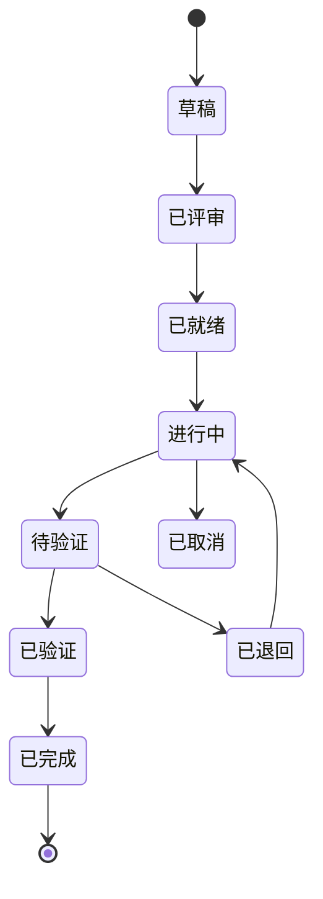

# 需求状态机与写入权

## 1. 状态



补充规则：

- `已验证` 只表示"可以进 PR"，**不代表已合并**。
- `已完成` 的条件：PR 已合并 develop **且** worktree 已回收。
- `已退回` 必须带退回原因（写进 `status.md` 的 `return_reason`）。
- `已取消` 可发生在 `草稿` 到 `待验证` 之间任意状态，需 BA 强制回收 worktree。

## 2. 单一写入者（Single Writer）

> 一个事实，只有一个角色能改。

| 文件 | 位置 | 唯一写入者 | 其他角色 |
|------|------|-----------|---------|
| `status.md` | `BA/demands/REQ-xxx/` | **BA** | 只能读 |
| `demand.md` / `acceptance.md` | 同上 | **BA**（QA 可提交修订建议） | 只能读 |
| `design-summary.md` | 同上 | **BA**（Dev 提供素材） | 只能读 |
| `test-cases/*.md` | `BA/demands/REQ-xxx/test-cases/` | **QA 写，BA 提交** | — |
| `.feature/manifest.json` | `feature-REQ-xxx/.feature/` | **Dev** | 只能读 |
| `.feature/traceability.md` | 同上 | **Dev** | 只能读 |
| `.feature/verification-report.md` | 同上 | **Dev**（自验） | QA 追加自己的 `qa-report.md` |
| `dispatch/agent-registry.md` | `BA/dispatch/` | **BA**（每次提交时顺带更新） | 只能读 |
| `dispatch/req-registry.md` | 同上 | **BA**（认领时写） | 只能读 |

**QA 不直接 commit 任何东西**：它产出报告内容，由 BA 落到 `demand` 分支。这样 `demand` 分支的历史里，永远只有 BA 的 session。

## 3. 状态变更的原子操作

对 `demand` 分支的每次状态变更必须是：

```bash
git pull --rebase origin demand
# 改 BA/demands/REQ-xxx/status.md（+ 心跳更新 dispatch/agent-registry.md）
git add BA/demands/REQ-xxx/status.md BA/dispatch/agent-registry.md
git commit -m "[BA] REQ-xxx: 进行中→待验证 (关联: REQ-xxx) [session: <id>]"
git push origin demand      # 失败 → pull --rebase → 重试（≤3 次）
```

提交信息的格式建议带上 `旧状态→新状态`，便于 `git log` 审计。

## 4. 门禁

| 门禁 | 条件 | 不满足时 |
|------|------|---------|
| 可以开工（`已就绪 → 进行中`） | `demand.md` + `acceptance.md` 非空，测试用例已生成 | 退回 `已评审` |
| 可以送审（`进行中 → 待验证`） | Dev 自验通过，`.feature/verification-report.md` 存在 | 留在 `进行中` |
| 可以开 PR（`待验证 → 已验证`） | QA Pre-merge 报告结论为通过 | 置 `已退回` |
| 可以合并 | `已验证` + CI 绿 | 阻塞 |
| 可以上线（`已验证 → 已完成`） | Post-merge e2e 通过 + worktree 已回收 | 阻塞 |
